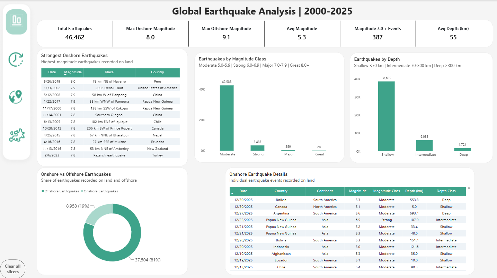
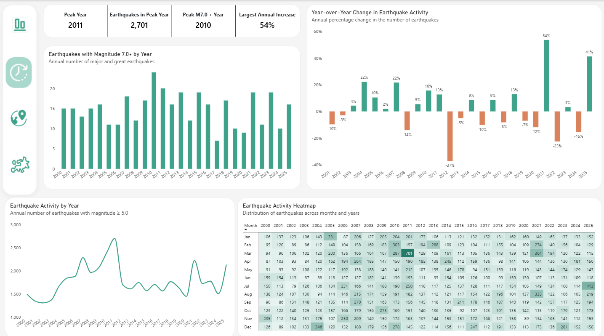
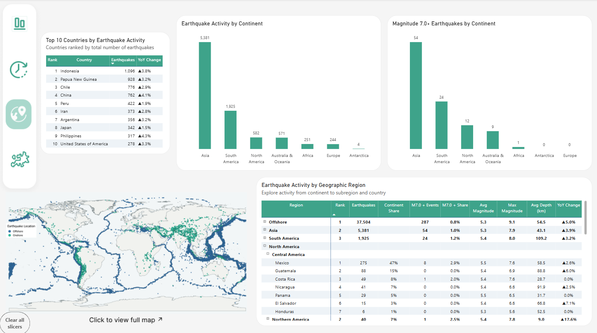
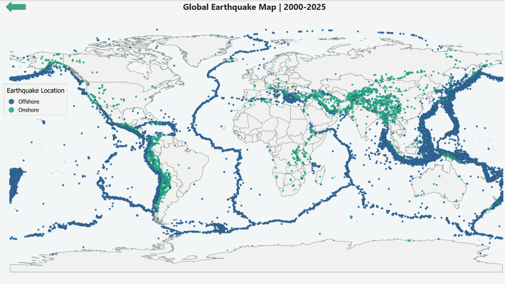
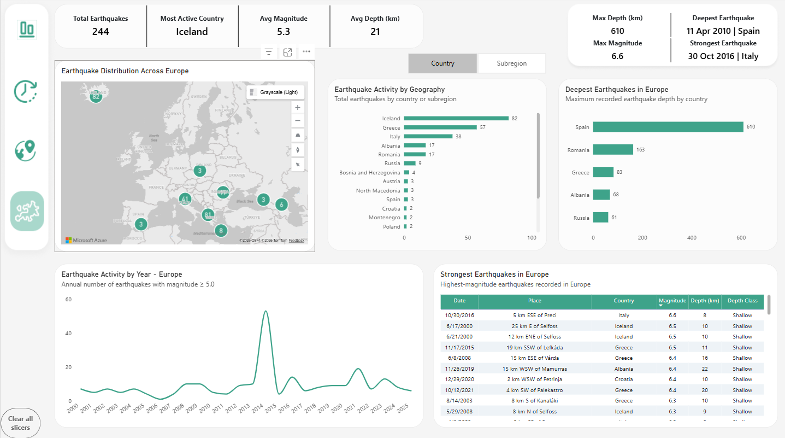

# Globalna analiza trzęsień ziemi 2000–2025

[English version](README.md)

[Zobacz interaktywny raport Power BI](https://app.fabric.microsoft.com/view?r=eyJrIjoiNzBjZmVmNjQtMmUwOC00Mjc2LWEwN2EtN2NhMGMzMmUzMWVlIiwidCI6IjI3ZWI2YjZjLWRhZWQtNDFkMS05NTJhLTM0ZDY0MjgzZWFhNSJ9&embedImagePlaceholder=true)

[Otwórz analizę Python w Google Colab](https://colab.research.google.com/drive/1mkUwWq1bZU7Vy5msHLRfapL_AFs6Uo-A?usp=sharing)

[Zobacz notebook Python na GitHubie](Python/earthquake_analysis_land_vs_offshore.ipynb)

## Opis projektu

Projekt przedstawia analizę **46 462 trzęsień ziemi** zarejestrowanych na całym świecie w latach **2000–2025**, o magnitudzie co najmniej **5,0**.

Projekt łączy **SQL Server, QGIS, Power BI i Python**, aby analizować aktywność sejsmiczną pod kątem czasu, geografii, magnitudy i głębokości.

Głównym celem analizy było sprawdzenie:

- jak aktywność sejsmiczna zmieniała się w czasie,
- gdzie trzęsienia ziemi były najbardziej skoncentrowane,
- które kraje i kontynenty odnotowały największą aktywność,
- jak trzęsienia różnią się pod względem magnitudy i głębokości,
- ile zdarzeń wystąpiło na lądzie, a ile offshore,
- gdzie wystąpiły najsilniejsze i najgłębsze trzęsienia,
- jak aktywność sejsmiczna w Europie wypada na tle globalnym.

Raport Power BI składa się z **czterech głównych stron**, prowadzących od ogólnego przeglądu do analizy czasowej, geograficznej i regionalnej. Uzupełniająca analiza w **Pythonie** koncentruje się na różnicach między trzęsieniami występującymi na lądzie i offshore pod względem magnitudy i głębokości.

## Źródło danych

Dane pochodzą z **USGS Earthquake Catalog**.

Zakres analizy:

- okres: **2000–2025**
- minimalna magnituda: **5,0**
- typ zdarzenia: **earthquake**
- zakres geograficzny: **cały świat**

Dane źródłowe zostały pobrane w kilku plikach CSV i zawierały informacje takie jak identyfikator trzęsienia ziemi, data i czas, współrzędne geograficzne, magnituda, głębokość, opis lokalizacji oraz status zdarzenia.

## Przygotowanie danych

Surowe pliki CSV zostały najpierw załadowane do **SQL Server**, gdzie dane połączono i zweryfikowano.

Proces walidacji obejmował sprawdzenie:

- liczby wszystkich i unikalnych rekordów,
- zduplikowanych identyfikatorów,
- zakresów dat i magnitud,
- brakujących wartości,
- nietypowych wartości głębokości,
- liczby trzęsień według lat i miesięcy.

Po walidacji zbiór zawierał **46 462 unikalne rekordy trzęsień ziemi**.

Następnie dane zostały przygotowane do raportowania w **Power Query**, gdzie wybrano potrzebne pola, ujednolicono typy danych i utworzono dodatkowe kolumny analityczne.

## Przygotowanie danych geograficznych w QGIS

Dane USGS zawierają współrzędne geograficzne, ale nie mają gotowej hierarchii analitycznej:

`Kontynent → Subregion → Kraj`

Dlatego do wzbogacenia danych o informacje geograficzne wykorzystano **QGIS**.

Punkty trzęsień ziemi zostały przestrzennie połączone z warstwami geograficznymi Natural Earth, dzięki czemu przypisano:

- kraj,
- kontynent,
- region,
- subregion,
- kod geograficzny.

Trzęsienia występujące poza granicami państw zostały sklasyfikowane jako **Offshore**.

Dodatkowo wprowadzono korekty dla Rosji, aby trzęsienia mogły być poprawnie przypisane do jej części europejskiej lub azjatyckiej.

Australia i Oceania zostały również połączone w jedną kategorię raportową:

`Australia & Oceania`

## Dlaczego do globalnej mapy wykorzystano QGIS

Pierwotnym założeniem było pokazanie wszystkich punktów trzęsień ziemi bezpośrednio w Power BI.

Jednak renderowanie ponad **46 000 punktów geograficznych** powodowało znaczne problemy z wydajnością i niestabilność raportu.

Zamiast ograniczać liczbę punktów, pełne rozmieszczenie trzęsień przygotowano w **QGIS**.

Na finalnej mapie rozróżniono:

- **trzęsienia Onshore**
- **trzęsienia Offshore**

oraz dodano granice państw dla lepszego kontekstu geograficznego.

Gotową mapę wyeksportowano w wysokiej rozdzielczości i dodano do Power BI. Większy widok mapy można otworzyć bezpośrednio ze strony Geographic Analysis, dzięki czemu użytkownik może dokładniej obejrzeć rozmieszczenie trzęsień bez wpływu na wydajność raportu.

## Model danych

Raport Power BI został zbudowany w oparciu o model faktów i wymiarów.

Główna tabela faktów:

`fEarthquakes`

Tabele wymiarów:

- `dCalendar`
- `dGeography`
- `dMagnitudeClass`

Model umożliwia analizę trzęsień według czasu, geografii, klas magnitudy i kategorii głębokości.

Klasy magnitudy:

- **Moderate** – 5,0–5,9
- **Strong** – 6,0–6,9
- **Major** – 7,0–7,9
- **Great** – 8,0+

Trzęsienia zostały również podzielone według głębokości:

- **Shallow** – poniżej 70 km
- **Intermediate** – 70–299,9 km
- **Deep** – 300 km lub więcej

## Miary DAX

Utworzono miary DAX wspierające dynamiczną analizę raportu.

Obejmują one obliczenia dotyczące:

- całkowitej liczby trzęsień,
- średniej i maksymalnej magnitudy,
- średniej głębokości,
- zdarzeń o magnitudzie 7,0+,
- aktywności onshore i offshore,
- zmiany rok do roku,
- rankingów geograficznych,
- udziału w aktywności kontynentu,
- najbardziej aktywnego roku,
- najbardziej aktywnego kraju,
- najsilniejszych i najgłębszych trzęsień.

Miary reagują dynamicznie na filtry i poziomy hierarchii geograficznej.

## Analiza Python | Land vs Offshore

Dodatkowa analiza została przeprowadzona w **Pythonie**, aby sprawdzić, czy **trzęsienia występujące na lądzie i offshore różnią się pod względem magnitudy i głębokości**.

Analiza obejmowała:

- kontrolę jakości danych,
- eksploracyjną analizę danych,
- porównanie trzęsień na lądzie i offshore,
- statystyki opisowe,
- wizualizację magnitudy i głębokości,
- **testy U Manna-Whitneya** dla magnitudy i głębokości.

Mediana magnitudy wyniosła **5,2 dla obu grup**, a test statystyczny nie wykazał **istotnej statystycznie różnicy w magnitudzie** między trzęsieniami na lądzie i offshore (**p = 0,177**).

W przypadku głębokości mediana wyniosła **32 km dla trzęsień na lądzie** i **22 km dla trzęsień offshore**. Test U Manna-Whitneya wykazał **istotną statystycznie różnicę w głębokości** między obiema grupami (**p < 0,001**).

[Otwórz analizę Python w Google Colab](https://colab.research.google.com/drive/1mkUwWq1bZU7Vy5msHLRfapL_AFs6Uo-A?usp=sharing)

[Zobacz notebook Python na GitHubie](Python/earthquake_analysis_land_vs_offshore.ipynb)

# Strony raportu

## 1. Overview

Strona Overview przedstawia najważniejsze informacje o całym zbiorze danych.

Główne KPI:

- **Total Earthquakes**
- **Max Onshore Magnitude**
- **Max Offshore Magnitude**
- **Avg Magnitude**
- **Magnitude 7.0+ Events**
- **Avg Depth (km)**

Strona zawiera również porównanie trzęsień według klasy magnitudy i głębokości, pokazuje udział zdarzeń onshore i offshore oraz umożliwia przeglądanie szczegółowych rekordów trzęsień.

## 2. Temporal Analysis

Ta strona koncentruje się na tym, jak aktywność sejsmiczna zmieniała się w latach **2000–2025**.

Zawiera:

- najbardziej aktywny rok,
- liczbę trzęsień zarejestrowanych w najbardziej aktywnym roku,
- rok z największą liczbą trzęsień o magnitudzie 7,0+,
- największy roczny wzrost aktywności sejsmicznej,
- roczne trendy aktywności,
- zmianę rok do roku,
- heatmapę aktywności według miesięcy i lat.

Analiza pokazuje, że **2011** był najbardziej aktywnym rokiem w zbiorze, z **2 701 trzęsieniami ziemi**.

## 3. Geographic Analysis

Strona Geographic Analysis porównuje aktywność sejsmiczną między kontynentami, subregionami i krajami.

Zawiera:

- **Top 10 Countries by Earthquake Activity**
- aktywność sejsmiczną według kontynentu,
- trzęsienia o magnitudzie 7,0+ według kontynentu,
- hierarchiczną macierz geograficzną,
- globalną mapę rozmieszczenia trzęsień ziemi.

Hierarchię można rozwijać według schematu:

`Kontynent → Subregion → Kraj`

Strona pokazuje również takie metryki jak liczba trzęsień, udział zdarzeń o magnitudzie 7,0+, średnia magnituda, maksymalna magnituda, średnia głębokość oraz zmiana rok do roku.

Globalna mapa została przygotowana w QGIS i rozróżnia trzęsienia **Onshore** i **Offshore**. Większą wersję mapy można otworzyć bezpośrednio ze strony Geographic Analysis.

  
  

## 4. Europe Deep Dive

Ostatnia strona koncentruje się na aktywności sejsmicznej w Europie.

Zawiera:

- całkowitą liczbę trzęsień,
- najbardziej aktywny kraj,
- średnią magnitudę,
- średnią głębokość,
- najsilniejsze trzęsienie,
- najgłębsze trzęsienie,
- aktywność według kraju lub subregionu,
- najgłębsze trzęsienia według kraju,
- aktywność w kolejnych latach,
- najsilniejsze trzęsienia w Europie.

Parametr geograficzny umożliwia przełączanie widoku między **Country** i **Subregion**.

W europejskiej części zbioru **Islandia** ma największą liczbę trzęsień, natomiast najgłębsze trzęsienie wystąpiło pod Hiszpanią na głębokości około **610 km**.

## Najważniejsze wnioski

Analiza pokazuje kilka istotnych wzorców:

- Zbiór zawiera **46 462 trzęsienia ziemi** o magnitudzie 5,0 lub większej.
- Około **81% zdarzeń zostało sklasyfikowanych jako offshore**.
- Najsilniejsze trzęsienie offshore osiągnęło magnitudę **9,1**.
- Najsilniejsze trzęsienie onshore osiągnęło magnitudę **8,0**.
- Większość trzęsień należy do klasy **Moderate (5,0–5,9)**.
- Większość trzęsień została sklasyfikowana jako **Shallow**.
- **2011** był najbardziej aktywnym rokiem, z **2 701 trzęsieniami**.
- Azja odnotowała największą liczbę trzęsień onshore spośród wszystkich kontynentów.
- Aktywność sejsmiczna jest silnie skoncentrowana wzdłuż głównych globalnych stref sejsmicznych.
- Analiza w Pythonie nie wykazała **istotnej statystycznie różnicy w magnitudzie** między trzęsieniami na lądzie i offshore.
- Analiza w Pythonie wykazała **istotną statystycznie różnicę w głębokości**, z medianą **32 km dla trzęsień na lądzie** i **22 km dla trzęsień offshore**.
- W Europie **Islandia** jest najbardziej aktywnym krajem w analizowanym zbiorze.
- Najgłębsze europejskie trzęsienie wystąpiło pod Hiszpanią na głębokości około **610 km**.

## Narzędzia i technologie

- **SQL Server**
- **SQL**
- **Power BI**
- **Power Query**
- **DAX**
- **QGIS**
- **Python**
- **CSV**
- **USGS Earthquake Catalog**
- **Natural Earth geographic data**
